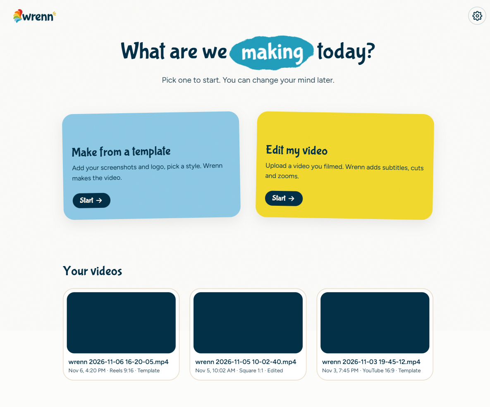
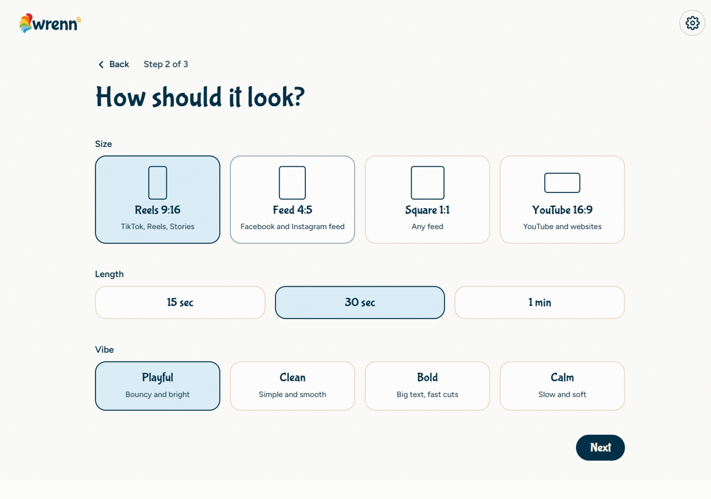
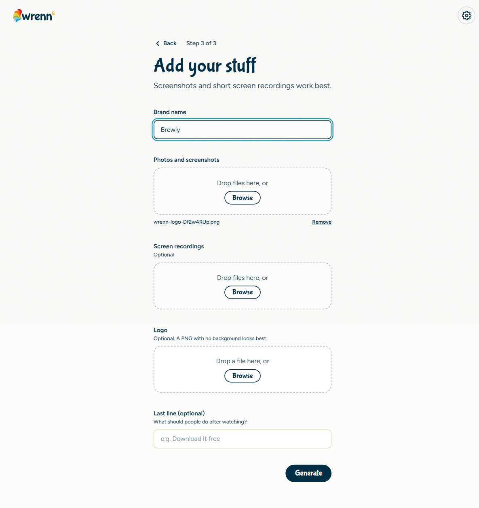
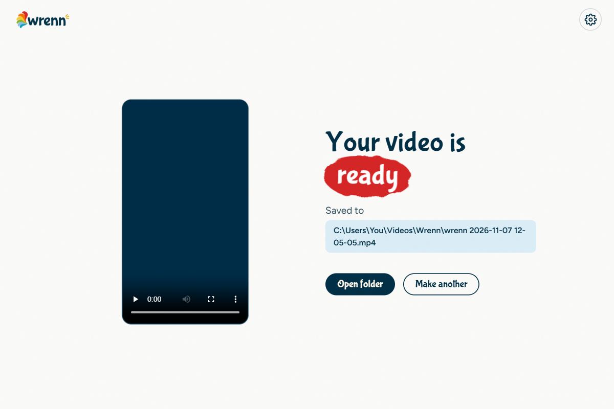

# Wrenn

**No prompts. Just render.**

Wrenn is a free desktop app that makes short motion graphics videos for your app or product. You give it your screenshots and your logo, pick a few options, and it makes a showreel style MP4 you can post. It uses your own Claude Code to build the video. You never type a prompt or open a terminal. You just click.



## How it works

Tap. Render. Post.

1. Open Wrenn. The first time, it checks that Claude Code is on your computer and signed in.
2. Pick a template, then a size (Reels, Feed, Square or YouTube), a length (15, 30 or 60 seconds) and a vibe.
3. Add your logo and screenshots (or a screen recording), your brand name and the line you want at the end.
4. Click **Make my video**. Wrenn works in the background while you wait.
5. Your MP4 lands in your `Videos\Wrenn` folder, ready to post.







## What you need

- **Windows.** A Mac version is planned for later.
- **Claude Code**, installed and signed in with a paid Claude plan. Wrenn doesn't come with its own AI. It runs the Claude Code you already have, so every video uses some of your own Claude Code usage.
- **An ElevenLabs key (optional).** Only if you want a new song made just for your video. Without one, Wrenn uses its own free songs, or you can add your own song, or pick no music.

## Download and install

1. Go to the [Releases page](https://github.com/lianxxxx/wrenn/releases) and download `Wrenn-Setup.exe` from the latest release.
2. Run it.
3. Windows will probably show "Windows protected your PC". That's because the app isn't code signed yet (signing costs money every year). Click **More info**, then **Run anyway**.
4. Wrenn installs for your user only, so it won't ask for admin rights. It adds a desktop shortcut and a Start menu shortcut.

## Privacy

- Everything stays on your computer. No account, no server, no tracking.
- Your ElevenLabs key is saved encrypted on your computer, using Windows' own protection.
- Your screenshots, logo and details only go to your own Claude Code. Claude Code only gets file tools, and only inside the folder Wrenn makes for that video.
- If you pick the ElevenLabs song option, Wrenn sends ElevenLabs a short description of the music (the vibe and the length). Your files are never sent there.

## For developers

Wrenn is open source. Lian builds it on her own as a side project, so issues and ideas are welcome.

### Repo layout

```
wrenn/
├── desktop/   the app (Electron, React, TypeScript, Vite, Tailwind)
│   ├── src/        main process, preload and screens
│   ├── templates/  video templates (instructions + starter scene)
│   └── resources/  music, sound effects and their credits
├── web/       the landing page (Next.js)
├── brand/     fonts, colors and logo drafts
└── docs/      research notes, specs and plans
```

### Run it

You need Node.js and Claude Code on your computer.

```
cd desktop
npm install
npm run dev
```

### Test it

```
cd desktop
npm test
```

This builds the app and runs the Playwright tests. No test starts a real video job, so Claude Code never runs. See [desktop/tests/README.md](desktop/tests/README.md) for what each test covers.

### Build the installer

```
cd desktop
npm run dist
```

The installer lands in `desktop/dist/`. See [desktop/PACKAGING.md](desktop/PACKAGING.md) for what gets bundled and where the app saves things.

### How a video gets made

1. Wrenn makes a **job folder**: it copies the template, your files and a `brief.json` with your choices (size, length, vibe, brand name, ending line).
2. It runs your Claude Code in the background in that folder (`claude -p "make my video"`, file tools only). Claude Code reads the template's `CLAUDE.md` and writes the video as a web page in `scene/index.html`, plus `scene/sound.json` for the sound effects. It writes `done.json` when it's finished.
3. Electron opens the scene and captures it frame by frame. Every scene can jump to any point in time (`seek(t)`), so the same scene always makes the same video.
4. FFmpeg turns the frames into an MP4 and mixes in the music and sound effects.

More on templates and the scene rules in [desktop/templates/README.md](desktop/templates/README.md).

## Credits

- **[motion-graphics.org](https://motion-graphics.org/)**: the templates take inspiration from this gallery of Claude-made motion graphics. No prompts were copied. Wrenn's prompts are written from scratch.
- **Music**: CC0 songs from [Free Music Archive](https://freemusicarchive.org/) by HoliznaCC0, Loyalty Freak Music, Komiku, Metre, Ondrosik, John Bartmann and Anonymous420.
- **Sound effects**: CC0 sounds by [Kenney](https://www.kenney.nl/), plus a few made for Wrenn.
- Full list of every song and sound, with links: [desktop/resources/CREDITS.md](desktop/resources/CREDITS.md).
- **[GSAP](https://gsap.com/)** 3.15.1 by GreenSock, for the animation in each video. Used under GreenSock's standard "no charge" license ([gsap.com/standard-license](https://gsap.com/standard-license)). The copyright notice stays at the top of the file.
- **Fonts**: [Figtree](https://github.com/erikdkennedy/figtree) by Erik Kennedy and Bubblegum Sans by Angel Koziupa and Alejandro Paul, both under the SIL Open Font License 1.1.
- **[FFmpeg](https://ffmpeg.org/)**, through [ffmpeg-static](https://github.com/eugeneware/ffmpeg-static). The Windows build Wrenn ships is a GPL build (GPL v3). See [ffmpeg.org/legal.html](https://ffmpeg.org/legal.html).
- **[Electron](https://www.electronjs.org/)**, **[React](https://react.dev/)** and **[Tailwind CSS](https://tailwindcss.com/)** for the app.

## License

Wrenn's code is under the [MIT License](LICENSE).

The parts that come from others keep their own licenses: the songs and sound effects are CC0, the fonts are under the SIL Open Font License, GSAP is under GreenSock's standard license, and FFmpeg is under its own license (GPL for the build Wrenn ships).
